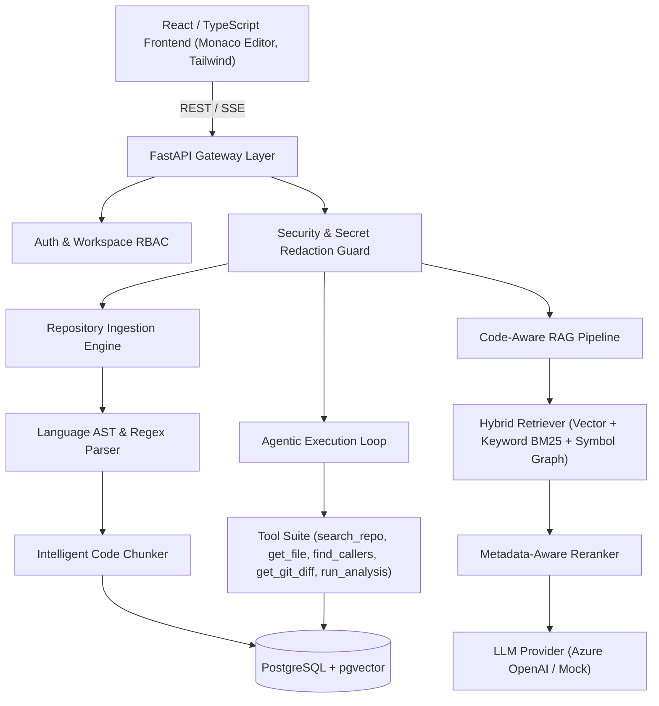

# CodePilot AI Architecture Overview

## Executive Summary
CodePilot AI is an enterprise-grade repository-aware agentic software engineering copilot. It allows developers to index software repositories, perform hybrid RAG retrieval across code symbols and vector embeddings, run controlled multi-step AI agent workflows, analyze bugs with proposed diff patches, conduct comprehensive code reviews, generate targeted unit tests, and evaluate RAG quality metrics.

## Core Subsystems
1. **Frontend**: Vite, React 18, TypeScript, Tailwind CSS, Monaco Editor (`@monaco-editor/react`), TanStack Query, Lucide icons, Recharts.
2. **API Layer**: FastAPI, Pydantic v2, Async SQLAlchemy 2.0, Alembic migrations.
3. **Data & Vector Storage**: PostgreSQL with `pgvector` for 1536-dim embeddings and metadata storage (`code_chunks`, `code_symbols`, `code_relationships`). Redis for rate limiting, session cache, and background task queues.
4. **Ingestion & AST Engine**: Supports tree-sitter / regex parsing for JS, TS, Python, Java, Go, C#, SQL, JSON, YAML, HTML, CSS, Markdown. Extracts functions, classes, imports, and relationships (`File A imports File B`, `Function A calls Function B`).
5. **RAG & Agent Pipeline**: Multi-phase hybrid vector search + metadata filters + AST symbol graph expansion + Agent tool orchestration with loop limits.
6. **Observability & Evaluation**: Token metrics, latency tracking, estimated LLM cost tracking, and automated retrieval precision/recall evaluation runner.
